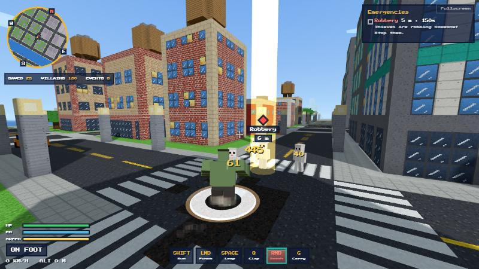
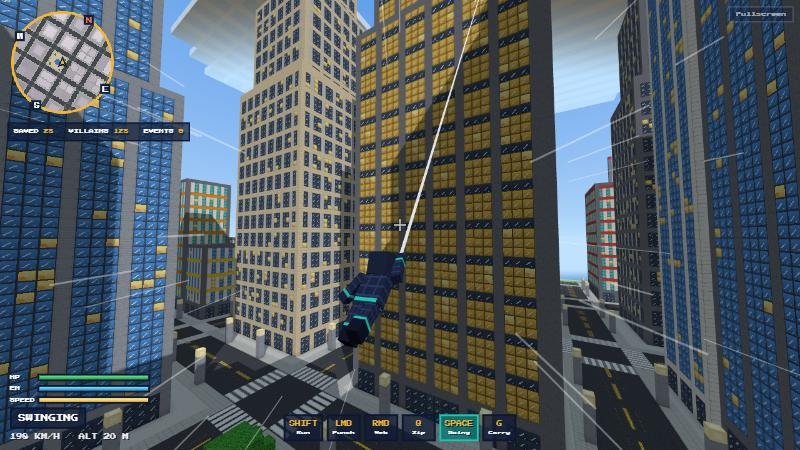
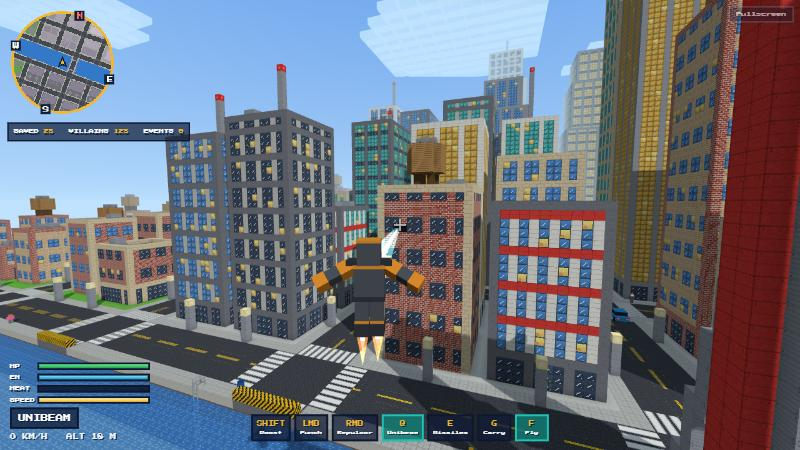
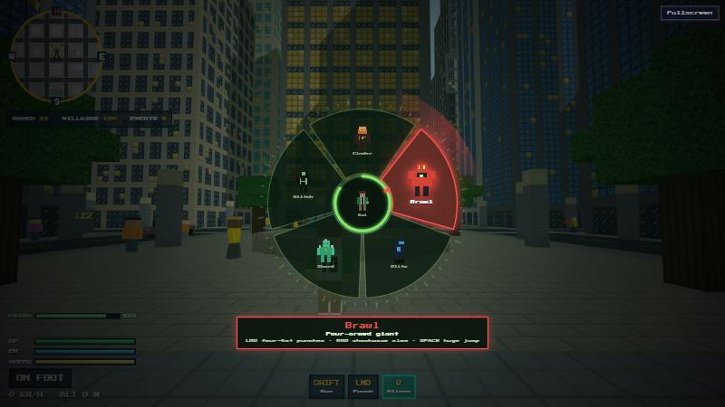
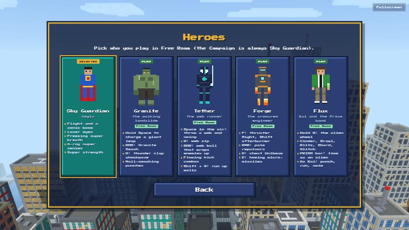

# ⚡ SuperCraft

**A blocky superhero game you can play right in your browser.**
Five heroes, one voxel city. Pick yours and save Brightport.

## Heroes

<table>
<tr>
<td width="50%"> <b>Sky Guardian</b>: flight, sonic booms, laser eyes, freezing breath, x-ray senses</td>
<td width="50%"> <b>Granite</b>: charged leaps, ground smash, thunder clap</td>
</tr>
<tr>
<td> <b>Tether</b>: web-swinging, web zip, wall running</td>
<td> <b>Forge</b>: armoured flight, repulsors, chest beam, homing missiles</td>
</tr>
<tr>
<td> <b>Flux</b>: a wristband that turns him into five different aliens</td>
<td> <b>Pick a hero</b> in the Heroes menu and play them in Free Roam</td>
</tr>
</table>

## What's in it

- 🏙️ **Free Roam:** an open city with traffic, people, car stealing and random emergencies to handle.
- 🎬 **Campaign:** five missions ending in a fight with a giant mech, rated with up to three stars.
- 🎨 Every texture and sound is made in code.

## New in 0.1

Four new heroes, a Heroes menu, drivable cars, ambulance rescues, swimming with ladders out of the water, an underwater view, cooldowns on the ability bar, and faster city loading.

## Play

Open the [live game](https://joji228.github.io/SuperCraft/), or run `python tools/serve.py 8080` and visit http://localhost:8080. **WASD** moves, the **mouse** looks and **Esc** pauses. Each hero's controls are shown in game.

Built with <a href="https://threejs.org">Three.js</a>. All heroes, Brightport and every villain are original creations. MIT licensed.
