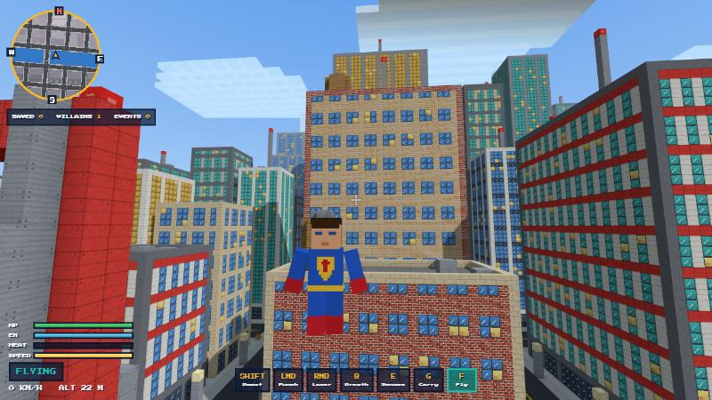
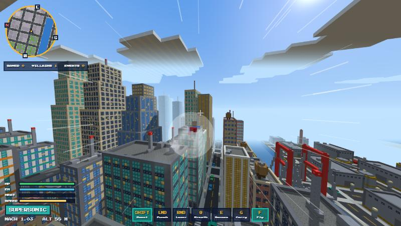
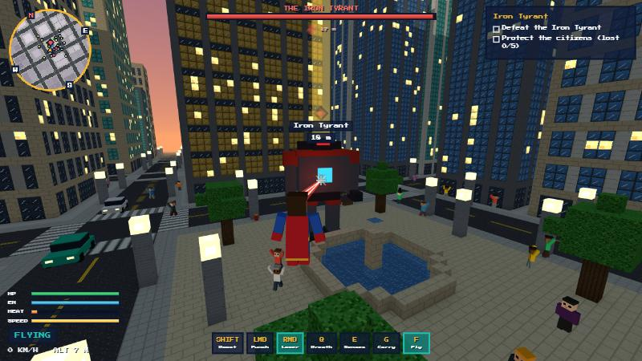
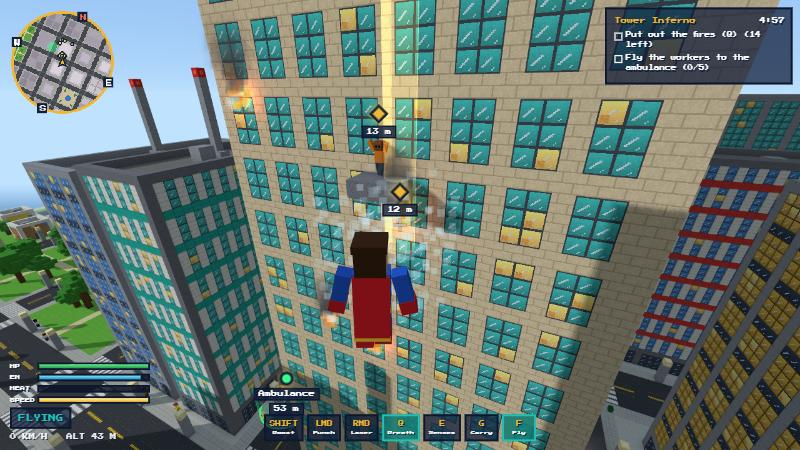
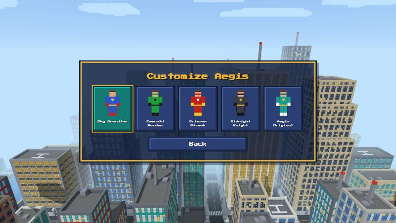

# ⚡ SuperCraft

**A blocky superhero game you can play right in your browser.**
Fly over a voxel city, break the sound barrier and save Brightport.

## What's in it

- 🦸 **Five powers:** flight with a sonic boom, laser eyes, freezing super breath, x-ray super senses and super strength (carry and throw cars).
- 🏙️ **An open city** with traffic, pedestrians and random emergencies: robberies, fires, crashes and drone attacks.
- 🎬 **A five-mission campaign** ending in a fight with a giant mech, rated with up to three stars.
- 🎨 **Five costumes**, and every texture and sound is made in code.

<table>
<tr>
<td></td>
<td></td>
</tr>
<tr>
<td></td>
<td></td>
</tr>
</table>

## Controls

| Key | Action |
| --- | --- |
| **WASD** · **Mouse** | Move · look (click the game to capture the mouse) |
| **Space** | Jump (double-tap in the air to fly) |
| **F** | Toggle flight · **Space / C** up and down |
| **Shift** | Super speed on foot · boost in the air (hold for a sonic boom) |
| **Left click** | Punch combo · throw what you carry |
| **Right click** (hold) | Laser eyes |
| **Q** (hold) | Super breath |
| **E** | Super senses |
| **G** | Pick up / drop |
| **Wheel click** | Lock on to a target |
| **R** | Free Roam: steal a car and drive (Shift nitro · Space drift · H horn · R get out) |
| **V** | Camera: close / medium / far / first person |
| **Esc** | Pause |

## Run it locally

Run `python tools/serve.py 8080` in the project folder and open http://localhost:8080.

Built with <a href="https://threejs.org">Three.js</a>. Aegis, Brightport and every villain are original creations. MIT licensed.
